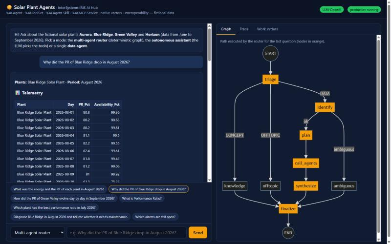
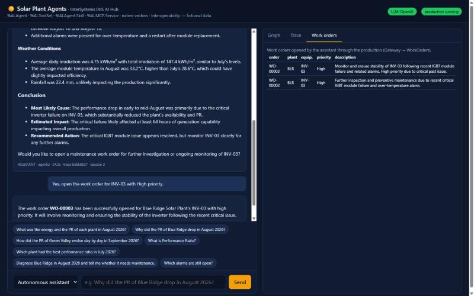
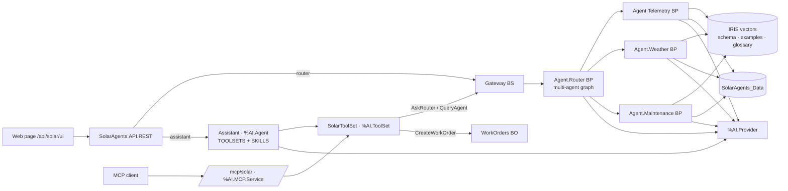
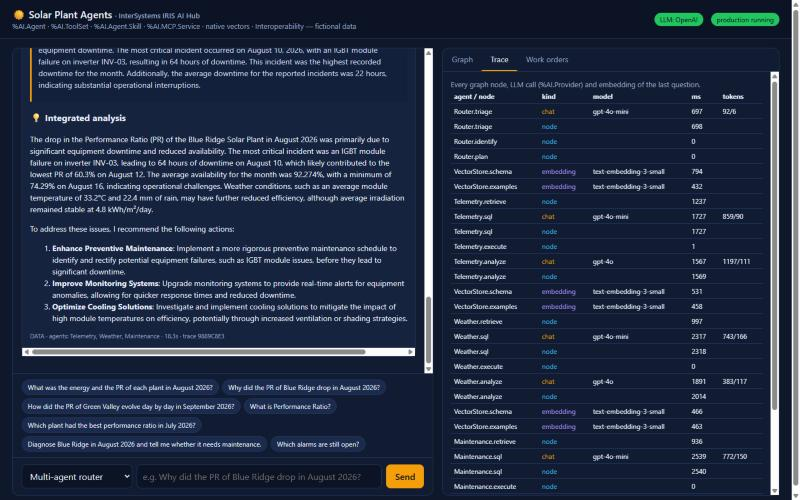

# IRIS AI Hub · Solar Plant Agents

An end-to-end demo of the **InterSystems IRIS AI Hub** (`%AI.*`): AI agents that answer questions about
**fictional** solar plants using agent graphs, text-to-SQL, RAG on native vectors, an autonomous assistant
with tools and *skills*, MCP and Interoperability — all running **inside IRIS**, with no LangChain, no
external vector database and no third-party Python packages.

> Every name, plant and number in this repository is made up for the demo.



## What the demo shows

| Capability | Where | Class |
|---|---|---|
| **%AI.Provider** — native, traced LLM calls | LLM gateway | `SolarAgents.Core.LLM` |
| **Declarative %AI.Agent** (`PROVIDER`, `MODEL`, `TOOLSETS`, `SKILLS`, `XData INSTRUCTIONS`) | autonomous assistant | `SolarAgents.Agent.Assistant` |
| **Persistent %AI.Agent.Session** — conversation memory across requests | `/ask` with `session_id` | `Assistant.Converse` |
| **%AI.ToolSet** — 8 tools described in XData | assistant and MCP tools | `SolarAgents.Tools.SolarToolSet` |
| **%AI.Agent.Skill** — packaged procedure the agent activates on its own | performance diagnosis | `SolarAgents.Skill.PerformanceAnalyst` |
| **%AI.MCP.Service** — the tools for any MCP client | `/mcp/solar` | `SolarAgents.MCP.Service` |
| **Declarative agent graphs** on `%AI.Agent` (nodes, conditional edges, cycles, `on_error`) | router and data agents | `SolarAgents.Graph.GraphAgent` |
| **Multi-agent** — the router calls Telemetry, Weather and Maintenance and cross-checks their answers | "why did the PR drop?" | `SolarAgents.Agent.Router` |
| **Text-to-SQL with guardrails and self-correction** — the IRIS error goes back to the LLM, which fixes the query | data agents | `SolarAgents.Agent.DataAgent` |
| **RAG on native vectors** (`VECTOR(DOUBLE,1536)` + `VECTOR_COSINE`) | schema, examples and glossary | `SolarAgents.RAG.VectorStore` |
| **Embedded Python** — statistics and IEC 61724 PR | deterministic analysis | `SolarAgents.Analysis.Analyzer` |
| **Interoperability** — every agent is a Business Process; the assistant opens work orders through a Business Operation | Visual Trace | `SolarAgents.Interop.*` |
| **Observability** — every node, LLM call and embedding, with tokens and timing, per question | *Trace* tab | `SolarAgents.Core.Trace` |
| **Offline mode** — without an API key the whole demo still works (retrieval-based SQL, template narratives) | default without `OPENAI_API_KEY` | `SolarAgents.Core.Config` |

## Quick start

**Requirements:** Docker and an **IRIS AI Hub** image (Early Access Program) loaded in Docker. The `%AI.*`
classes exist only in those builds: [evaluation.intersystems.com/Eval/early-access/AIHub](https://evaluation.intersystems.com/Eval/early-access/AIHub).
Prefer the `irishealth-community` AI images — they ship the web gateway used by the page and by MCP.

```bash
docker load -i irishealth-community-<version>AI-docker.tar.gz
cp docker/.env.example docker/.env     # set IRIS_IMAGE to the loaded tag; OPENAI_API_KEY is optional
docker compose -f docker/docker-compose.yml up -d --build
```

Open **http://localhost:52773/api/solar/ui** (or the port set in `IRIS_WEB_PORT`).

| Mode | When | What happens |
|---|---|---|
| **OpenAI** | `OPENAI_API_KEY` is set | triage, SQL, analyses and the assistant use the LLM through `%AI.Provider` |
| **Offline** | no key | the graphs run the same way; SQL comes from the closest example in the vector store (with the plants and period of the question) and narratives are built from the statistics. The autonomous assistant requires a key. |

Management Portal: `http://localhost:52773/csp/sys/UtilHome.csp` (user `_SYSTEM`, password `SYS`, namespace **SOLAR**).
Under *Interoperability → Production* you see `Gateway → Agent.Router → Agent.Telemetry / Agent.Weather / Agent.Maintenance`
and, in the Visual Trace, every question flowing through the agents.

## Questions for the presentation

| Question | Mode | What it shows |
|---|---|---|
| What was the energy and the PR of each plant in August 2026? | Router | text-to-SQL, ranking, narrative |
| Why did the PR of Blue Ridge drop in August 2026? | Router | 3 agents (telemetry, weather, maintenance) + integrated analysis (INV-03 failure) |
| How did the PR of Green Valley evolve day by day in September 2026? | Router | daily series: soiling until the rain of Sep 24 |
| What is Performance Ratio? | Router | RAG over the glossary (CONCEPT branch) |
| Which plant had the best performance ratio in July 2026? | Router | SQL self-correction |
| Diagnose Blue Ridge in August 2026 and tell me whether it needs maintenance. | Assistant | skill + 6 tools chosen by the LLM |
| Yes, open the work order for INV-03 with High priority. | Assistant (same session) | session memory + action in the production (WorkOrders) |

The full script, with talking points and timing, is in [docs/presentation-script.md](docs/presentation-script.md).



## The data story (June to September 2026)

| Plant | Code | Scripted situation |
|---|---|---|
| Aurora Solar Plant | AUR | reference plant, PR ~84% |
| Blue Ridge Solar Plant | BLR | inverter **INV-03** fails from Aug 10 to Aug 18 → availability ~75% and PR ~61% |
| Green Valley Solar Plant | GRV | hot site + **soiling** in September until the heavy rain of Sep 24 |
| Horizon Solar Plant | HZN | single-axis trackers, commissioned on Jul 1, 2026 |

Tables: `SolarAgents_Data.Plant`, `Generation` (daily telemetry), `Weather`, `Alarm`, `WorkOrder`.

## Architecture



Graphs, data flow and design decisions are detailed in [docs/architecture.md](docs/architecture.md).



## API

| Method | Route | Description |
|---|---|---|
| GET | `/api/solar/ui` | demo page |
| POST | `/api/solar/ask` | `{"question", "mode": "router\|assistant\|Telemetry\|Weather\|Maintenance", "session_id"}` |
| GET | `/api/solar/health` | LLM provider, production, knowledge base |
| GET | `/api/solar/graph/Router` | Mermaid diagram of any graph (`Router`, `Telemetry`...) |
| GET | `/api/solar/trace/<trace_id>` | nodes, LLM calls and embeddings of one question |
| GET | `/api/solar/plants`, `/api/solar/workorders` | auxiliary data |

```bash
curl -s -H "Content-Type: application/json" \
  -d '{"question":"Why did the PR of Blue Ridge drop in August 2026?","mode":"router"}' \
  http://localhost:52773/api/solar/ask
```

Questions in Portuguese are answered in Portuguese (the router translates the final answer).

## MCP

`SolarAgents.MCP.Service` publishes the 8 tools at `/mcp/solar`. The catalog can be checked directly:

```bash
curl -s -H "X-IRIS-MCP-Server: 1" http://localhost:52773/mcp/solar/v1/services
```

The `iris-mcp-server` sidecar (which connects clients such as Claude Desktop or VS Code) starts with
`docker compose -f docker/docker-compose.yml --profile mcp up -d` and listens on port 8888.

## Tests

Offline suite (no key needed):

```objectscript
zn "SOLAR"
do ##class(SolarAgents.Tests.DemoTest).Run()
```

It covers the question parser, the SQL guardrails, vector search, the data agents, the router branches, the
root-cause analysis, the PR calculator, the tool and skill registration, the work-order action and the trace.

Development: `bash docker/dev-load.sh` reloads `src/` into the running container.

## Layout

```
src/SolarAgents/
  Core/       Config, LLM (%AI.Provider), Trace, QueryParser, SQL (guardrails), Dispatch, Isolate
  Graph/      GraphAgent — declarative graph engine on %AI.Agent
  Agent/      Router, DataAgent, Telemetry, Weather, Maintenance, Assistant
  Skill/      PerformanceAnalyst (%AI.Agent.Skill)
  Tools/      SolarToolSet (%AI.ToolSet)
  MCP/        Service (%AI.MCP.Service)
  RAG/        Chunk, VectorStore (VECTOR + VECTOR_COSINE)
  Knowledge/  Base — schema, SQL examples and glossary
  Analysis/   Analyzer (Embedded Python)
  Interop/    Production, Gateway, AgentProcess, WorkOrderOperation, messages
  Data/       Plant, Generation, Weather, Alarm, WorkOrder, DemoData
  API/        REST + web page
  Setup/      Installer
  Tests/      DemoTest
docker/       Dockerfile, docker-compose.yml, iris.script, entrypoint.sh, mcp-config.toml
docs/         architecture, presentation script, images
```

## Notes on the EAP build used (2026.3.0AI.136)

The AI Hub is still in Early Access; the demo works around three behaviors observed in that build:

- **LLM call nested in a tool call.** When a `%AI.Agent` tool makes another LLM call in the same process, the
  AI-Core bridge fails. Tools that use the LLM, and the assistant itself, run in a separate process
  (`SolarAgents.Core.Isolate`).
- **Embeddings.** `%AI.RAG.Embedding.OpenAI.EmbedBatch` only works inside the `KnowledgeBase` bridge. The demo
  computes embeddings through the OpenAI-compatible API and stores everything in native `VECTOR` tables.
- **MCP sidecar.** In that build, `iris-mcp-server` service discovery over the binary channel returns 404 for
  application MCP services (the catalog answers normally over HTTP, as in the `curl` above).

## Security

This is a **demo meant to run locally**: the `/api/solar` web application accepts unauthenticated access and
`_SYSTEM` uses the default password. Do not expose the container on a public network without enabling
authentication, changing passwords and restricting the application roles. Never commit `docker/.env`
(already in `.gitignore`).

## License

[MIT](LICENSE)
