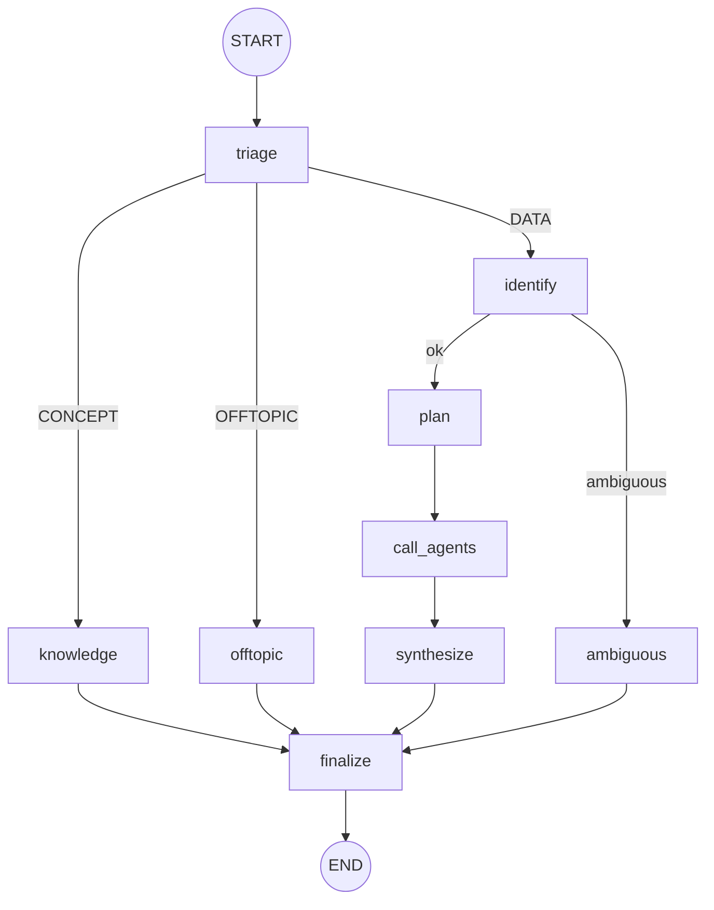
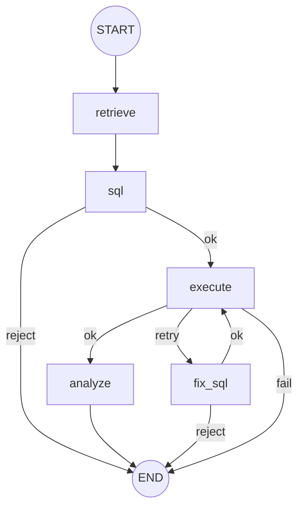
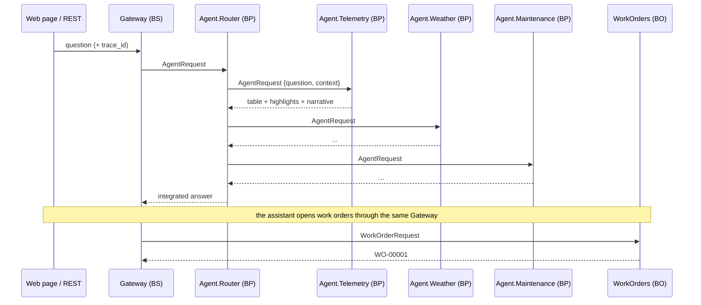

# Architecture

## Two agent styles, side by side

| | Router (graph) | Assistant (autonomous) |
|---|---|---|
| Class | `SolarAgents.Agent.Router` (`GraphAgent` → `%AI.Agent`) | `SolarAgents.Agent.Assistant` (`%AI.Agent`) |
| Who decides the path | the graph declared in `XData Graph` | the LLM, calling tools from the `%AI.ToolSet` |
| Predictability | high — every question follows an auditable path | flexible — combines tools as the conversation goes |
| Works offline | yes | no (needs an LLM) |
| Typical use | recurring questions, dashboards, integrations | investigation, diagnosis, actions on confirmation |

The demo shows both living together: the assistant uses the router as a **tool** (`AskRouter`).

## Graph engine on `%AI.Agent`

`SolarAgents.Graph.GraphAgent` extends `%AI.Agent` and runs a graph declared in JSON:

```json
{
  "start": "retrieve",
  "on_error": "END",
  "nodes": { "retrieve": "RetrieveNode", "sql": "SqlNode", "execute": "ExecuteNode", "fix_sql": "FixSqlNode", "analyze": "AnalyzeNode" },
  "edges": {
    "retrieve": "sql",
    "sql":      { "router": "RouteAfterSql", "map": { "ok": "execute", "reject": "END" } },
    "execute":  { "router": "RouteAfterExecute", "map": { "ok": "analyze", "retry": "fix_sql", "fail": "END" } },
    "fix_sql":  { "router": "RouteAfterSql", "map": { "ok": "execute", "reject": "END" } },
    "analyze":  "END"
  }
}
```

- **Node** = method `Method XNode(state As %DynamicObject) As %Status`.
- **Conditional edge** = router method that returns a key of `map`.
- **Cycles** are allowed (`execute → fix_sql → execute`), with a step limit (`MAXSTEPS`).
- **`on_error`** tells where to go when a node throws.
- Every executed node becomes a row in `SolarAgents_Core.Trace`; `Mermaid()` draws the graph (`/api/solar/graph/<agent>`).

### Router



| Node | Does | LLM? |
|---|---|---|
| triage | classifies CONCEPT / DATA / OFFTOPIC; keyword guardrails | yes (offline: rules only) |
| identify | plants and period of the question (`QueryParser`) | no |
| plan | picks the agents; cause questions ("why…") call all three | no |
| call_agents | calls each agent — through the production when it is running | — |
| synthesize | joins tables and narratives; integrated analysis of the evidence | yes (offline: highlights) |
| knowledge | RAG over the glossary | yes (offline: best chunk) |
| finalize | translates to Portuguese when the question is in Portuguese | yes |

### Data agents (Telemetry, Weather, Maintenance)



1. **retrieve** — vector search over the `schema` (table descriptions and rules) and `examples` (question → SQL) collections.
2. **sql** — the LLM writes the SELECT with the schema, the examples and an exact date context. Offline: the closest
   example with `{PLANTS}`, `{START}` and `{END}` filled in.
3. **guardrails** (`SolarAgents.Core.SQL.Validate`) — a single statement, SELECT only, only the agent's tables.
4. **execute** — if IRIS rejects the query, **fix_sql** sends the error back to the LLM, which rewrites it (once).
5. **analyze** — statistics, highlights and table in **Embedded Python**; the LLM writes the narrative from those numbers.

## RAG on native vectors

```sql
SELECT TOP ? Content, Metadata, (1 - VECTOR_COSINE(Embedding, TO_VECTOR(?, DOUBLE))) AS Score
FROM SolarAgents_RAG.Chunk WHERE Collection = ? ORDER BY Score
```

Three collections, loaded from `SolarAgents.Knowledge.Base` (XData JSON) and re-embedded automatically when
their content or the provider changes. Offline, the embeddings are hashed bag-of-words vectors — search stays lexical.

## Interoperability



The `trace_id` crosses every process, so `/api/solar/trace/<id>` shows the whole question (nodes, LLM calls
and embeddings of every agent) while the Visual Trace shows the messages.

## Process isolation

In the EAP build used, an LLM call made inside a tool call of a `%AI.Agent`, in the same process, breaks the
AI-Core bridge. Therefore:

- `AskRouter` and `QueryAgent` run in a separate job (`SolarAgents.Core.Isolate`), which forwards the `trace_id`.
- When called from the web, the assistant also runs in a fresh job for every turn; the conversation memory lives
  in the persisted `%AI.Agent.Session`.
